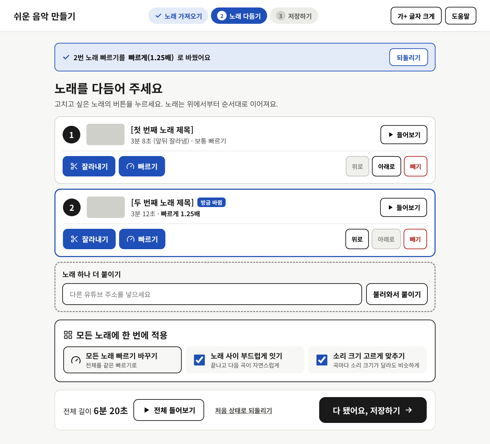

# 쉬운 음악 만들기 (music-downloader)

유튜브 링크로 노래를 불러와 **잘라내기 · 빠르기 · 이어 붙이기**를 하고 mp3로 저장하는 PC 웹 서비스.
디지털에 익숙하지 않은 사용자도 쓸 수 있는 **쉬운 UI/UX**가 목표입니다.

## 문서

| 문서 | 내용 |
|---|---|
| [docs/PLAN.md](docs/PLAN.md) | 요구사항, 사용자 흐름, UX 원칙, 적용 범위 규칙, 아키텍처, API, 개발 순서, 리스크, 결정 기록 |
| [docs/wireframes/png](docs/wireframes/png) | 화면 7개 와이어프레임 이미지 |
| [docs/wireframes/html](docs/wireframes/html) | 브라우저로 여는 와이어프레임 (`Main.html`부터, 화면 간 링크 연결) |
| [docs/wireframes/source](docs/wireframes/source) | 디자인 캔버스 원본 소스 (`.dc.html`) |

## 기술 스택 (예정)

React + TypeScript · FastAPI · Celery + Redis · yt-dlp · ffmpeg · Docker Compose
